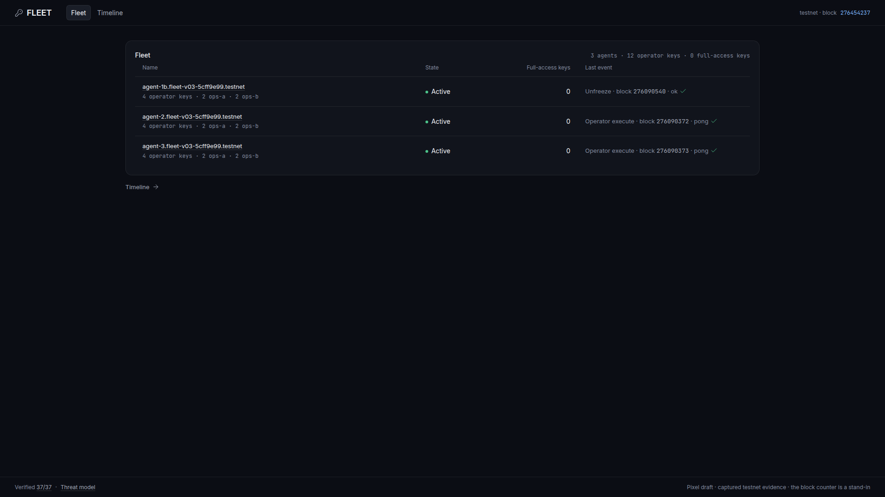
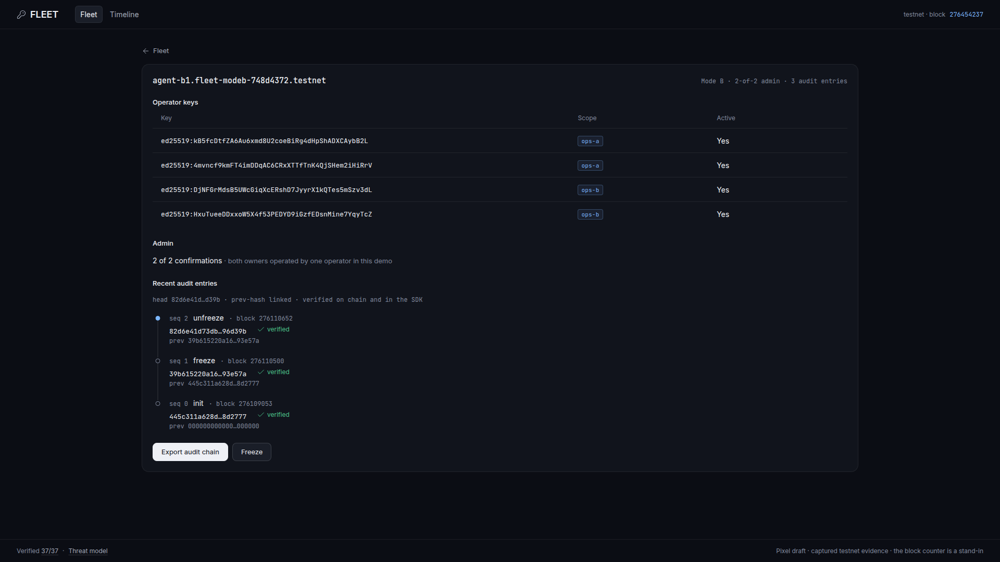
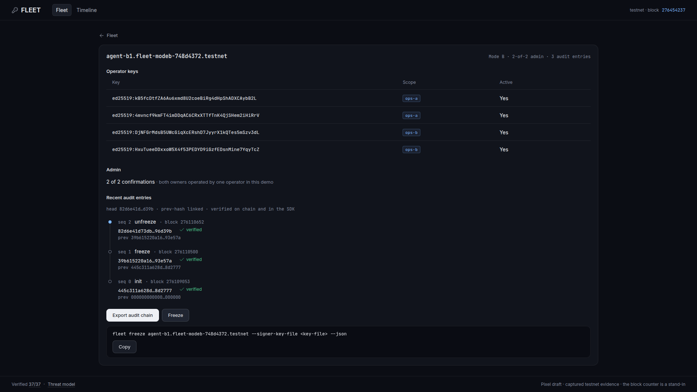
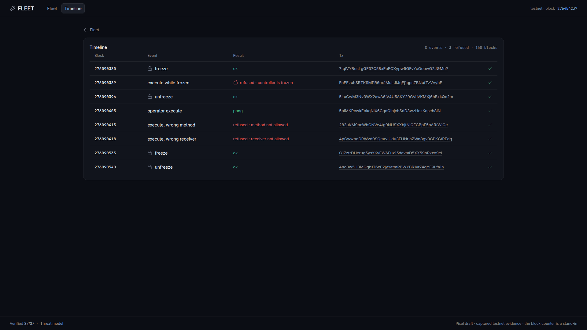

# Pixel draft review (v0.3, DRAFT — awaiting approval)

**Status: DRAFT. No Figma file was provided, so no Figma work was done. No
recording was made.** This companion collects the pixel draft for the human's
approval. Nothing here ships as `web/` code; `design/index.html` is a static
prototype served separately.
**Date:** 2026-11-04 UTC; backend status refreshed 2026-11-06 UTC; console
refined 2026-11-07 UTC under the human-approved `unslop` direction.

Backend stands as recorded in `research/BUILD_STATUS.md` §12: 84/84 Rust,
41/41 TypeScript, differential reference model 3 × 5,000 steps, automated
mutation 248/252 = 98.41%, integration 7/7 on x64 CI, Mode A and Mode B
20-run latency recorded, Mode A 63 checks and Mode B 52 checks deployed,
37/37 claims. The latency measurement that this review asked for has been
run (F-029…F-032, `evidence/latency-v03/run.json`); no latency number in this
draft is a claim, and the draft still shows no "seconds" wording.

---

## What was delivered

| File | What |
| --- | --- |
| `../docs/DESIGN_SYSTEM.md` | Amended system (Inter + JetBrains Mono, three screens, fleet first) |
| `../docs/CONSOLE_DRAFT.md` | Amended five→three-screen draft; Mode B folded into the admin row |
| `DEVIATIONS.md` | D-01: actions without keys (command sheet, no signing) |
| `index.html` | Pixel draft, one file, no live calls |
| `fonts/` | Self-hosted Inter + JetBrains Mono with OFL 1.1 texts |
| `screenshots/*.png` | 1920×1080 captures from the draft |

## Screens (screenshots)

### Fleet (`#`)

Three Mode A agents (`evidence/testnet-v03/run.json`): state, full-access key
count (0 everywhere), last event with its block and verified tx link, and a
second quiet line with the key material inside each agent (`4 operator keys ·
2 ops-a · 2 ops-b`). The panel header carries the real aggregate (`3 agents ·
12 operator keys · 0 full-access keys`). Last events are honest: agent-1b's
final unfreeze (block 276090540), the 12-way concurrent operator executes for
the other two (blocks 276090372–73). The top bar carries the two routes and
the testnet chip; the chip's block (`276454237`, the 2026-11-06 verify log)
ticks as a labelled stand-in, because this static draft has no RPC.

### Agent (`#agent=…`)

One agent at a time. Shown: `agent-b1.fleet-modeb-748d4372.testnet`
(`evidence/modeb-v03/run.json`) — four operator keys (`native_keys`) with their
scope tags as chips, the admin row `2 of 2 confirmations · both owners operated
by one operator in this demo`, and the 3-entry audit chain drawn as a chain
spine: sequence, action, block, entry hash, `prev` hash and the verified mark,
with the head node carrying the one accent. The chain was verified on chain and
in the SDK (`on_chain_verify` and `js_verify` both true).

The only action surface: Freeze opens the sheet with the exact CLI command
and Copy. The console still signs nothing. The sheet fades and rises 4 px; the
screen still fits 1080 px with it open.

### Timeline (`#timeline`)

Mode A lifecycle rows (`evidence/testnet-v03/run.json` lifecycle): freeze,
frozen refusal (`controller is frozen`), unfreeze, `pong` positive control,
wrong-method and wrong-receiver refusals, and the final freeze/unfreeze. Freeze
and unfreeze carry a closed or open lock; the frozen refusal carries the closed
lock in the danger colour. The panel header carries the real counts (`8 events ·
3 refused · 160 blocks`). Every row links its full hash to NearBlocks.

## Decisions to be challenged

1. **Command sheet instead of wallet-signed writes.** Freeze/Unfreeze open a
   copyable CLI command; the page never signs. This keeps the browser out of
   key handling entirely, at the cost of UX friction (copy, switch terminal,
   run). Challenge: is the friction acceptable for the "make the demo live"
   goal, or should a later gate add wallet signing behind its own design and
   threat review (DEVIATIONS.md D-01)?
2. **Static prototype vs. live RPC.** The draft renders captured `evidence/`
   data and a ticking block counter, with no RPC calls. It shows exactly what
   the demo will show, but the ticker is a counter, not a subscription, and
   screenshots pin one block height. Challenge: should the next step wire the
   header to a real block subscription first, or keep the mock for the
   split-screen demo and wire calls only after approval?
3. **Mode B trimmed to one admin row.** The draft folds the entire Mode B
   story into `2 of 2 confirmations · both owners operated by one operator`
   and drops the Mode B
   timeline (confirmations, duplicate-confirm refusal) from the pixel draft.
   Challenge: is that the right trim, or does the reviewer need the
   confirmation rows visible to understand the 2-of-2 mechanism?

## Known gaps (not solved by this draft)

- **Latency (closed).** The review asked for a 20-run optimistic-inclusion
  remeasure with p50/p95 and claims first. That run is complete and in
  `CLAIMS.md` (F-029…F-032, `evidence/latency-v03/run.json`): Mode A freeze
  single-transaction optimistic p50 5,567 ms / p95 13,227 ms, final p50
  13,251 ms / p95 24,753 ms; Mode B is three transactions per transition.
  The draft repeats none of these as "seconds" and no draft metric is a
  claim; the numbers live in `README.md` and `CLAIMS.md`.
- **Frozen fleet row.** The fleet screenshot shows three `Active` rows because
  the captured final states are all `Active`. A `Frozen` row will appear in
  live use the block it lands; there is no frozen-state screenshot today.
- **Mainnet guard and tamper banner** are specified (plain language) but are
  not rendered in the draft; they need a captured failing state before anyone
  screenshots them.
- **unslop skill.** Reviewed and pinned on 2026-11-06 (`a6f121eee5f29c2f74976b754
  56feae8b66afb3a`, CC BY 4.0, © Damir Sokolovsky / `@heydamir`), then applied
  as an audit (`design/UNSLOP_AUDIT.md`). On 2026-11-07 the human approved
  scope **B — polish plus direction**, and the draft now carries the nine
  passes: ink ramp and hairline borders, 4 px rhythm, one icon set, the copy
  fixes, `tabular-nums`, a viewport-filling shell, the chain spine, the lock
  marks and the scope-tag signature. The UI is still unapproved and nothing
  was recorded.
- **Figma.** None. No file link was provided; nothing was generated.

## Approve or amend?

Reply with approve, or the amendments you want. Until then: no further UI
work, no recording, no Figma.
